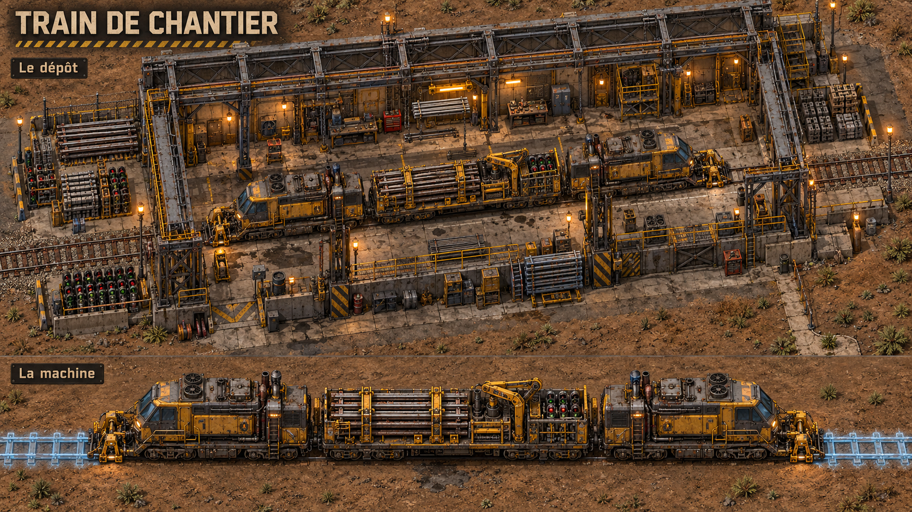

# Référence visuelle — Train de chantier

Concept retenu comme référence par Geoffrey le 30 octobre 2026 : bâtiment-atelier industriel et train fixe locomotive — wagon central — locomotive. À conserver pour guider les graphismes et éventuellement illustrer la documentation finale.

Cette planche a été générée avec l’outil intégré imagegen. Ce n’est ni une capture de Factorio, ni une feuille de sprites prête à intégrer. La [consigne de génération](train-depot-v1.prompt.txt) est conservée à côté de l’image.

La validation finale se fera dans le jeu, au zoom habituel, avec les orientations et animations réelles. Si la planche figure dans la documentation, la légender comme concept pour la distinguer des captures du mod.

L’original généré est conservé ; le fichier présent est une copie sans modification.
