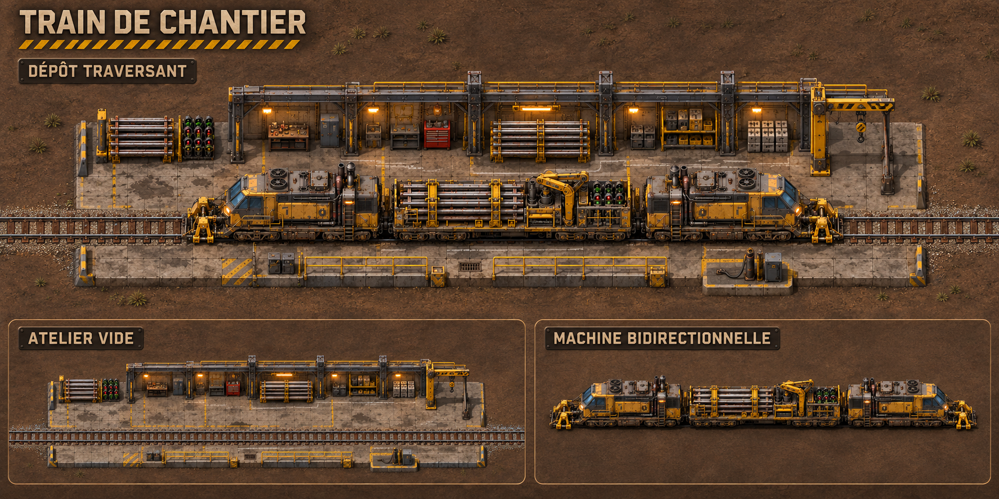
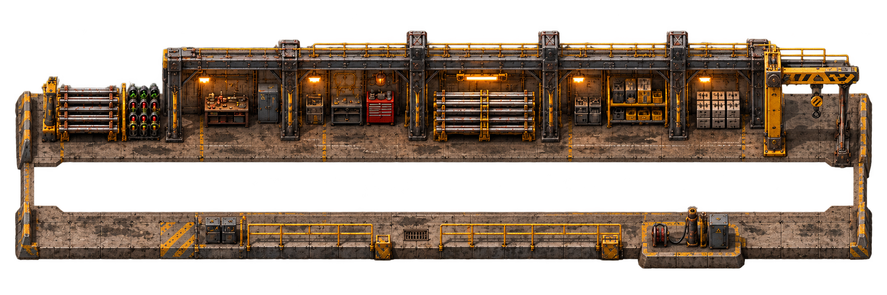

# Référence visuelle — Train de chantier

Concept retenu comme référence par Geoffrey le 30 octobre 2026 : bâtiment-atelier industriel et train fixe locomotive — wagon central — locomotive. À conserver pour guider les graphismes et éventuellement illustrer la documentation finale.

Cette planche a été générée avec l’outil intégré imagegen. Ce n’est ni une capture de Factorio, ni une feuille de sprites prête à intégrer. La [consigne de génération](train-depot-v1.prompt.txt) est conservée à côté de l’image.

La validation finale se fait dans le jeu, au zoom habituel, avec les orientations et animations réelles. L'essai utilisateur et ses captures du 3 novembre 2026 ont motivé la correction décrite ci-dessous ; le rendu corrigé reste à qualifier. Si la planche figure dans la documentation, la légender comme concept pour la distinguer des captures du mod.

L’original généré est conservé ; le fichier présent est une copie sans modification.

## Étude du dépôt traversant — 3 novembre 2026

Nouvelle proposition générée avec l'outil intégré imagegen à partir de la référence initiale, après validation fonctionnelle du module traversant. Elle conserve le jaune chantier et l'acier sombre, dégage les deux raccords et montre séparément le dépôt occupé, l'atelier vide et le train de trois véhicules. La référence initiale est conservée sans remplacement.

La [consigne complète](train-depot-v2.prompt.txt) et le [découpage de production](design-production.md) sont conservés avec l'image. La planche reste une proposition de direction artistique à examiner ; ce n'est ni une capture du jeu ni une feuille de sprites prête à intégrer. Aucun changement des graphismes du runtime n'est effectué par cette étude.

## Vue pilote fidèle à la référence

Après rejet de l'essai 3D procédural trop simplifié, cette vue reprend directement les détails mécaniques, les portiques et la patine des planches conservées. Elle est générée avec l'outil intégré imagegen ; sa [consigne](depot-faithful-study.prompt.txt) est conservée. Geoffrey a approuvé cette base pour produire les quatre vues intégrées au mod. La planche reste une référence, pas une capture du jeu. Le modèle 3D écarté reste hors du runtime.

## Retour en jeu et correction du stock intégré

Le 3 novembre 2026, l'utilisateur a essayé le module en jeu et fourni des captures. Il refuse le coffre au milieu de l'atelier ainsi que l'ancien voile gris avec liseré jaune. Le bâtiment représente désormais le stock intégré : son ouverture donne accès à 100 emplacements. Le conteneur technique reste invisible au même emplacement pour conserver son inventaire, ses contenus et les échanges avec les bras.

Les quatre PNG runtime du bâtiment, leurs échelles et leurs origines sont inchangés. La découpe centrale autour du stock est supprimée ; seules deux bandes complètes de part et d'autre du couloir ferroviaire de ±1,5 case sont rendues. L'ancien rendu est supprimé par `Runtime.initialize` sans recréer les entités ni leurs inventaires.

L'ancien `graphics/entity/depot/stock.png` est conservé hors du runtime sous [stock-study.png](stock-study.png), comme étude du coffre écarté. L'[aperçu hors jeu](../depot-sprite-preview.html) montre le bâtiment avec son stock intégré, sans coffre séparé ni réservation rose.

Un retour ultérieur demande un sol métallique continu sous la voie, comme dans Train Foundry, et une zone de chargement plus longue. La texture de sol de ce mod est réutilisée sans retouche sous les rails du dépôt ; les quatre vues du bâtiment restent intactes. L'accès par bras s'étend le long de l'atelier, avec un seul inventaire de 100 emplacements conservé.

**Qualification moteur réussie** : suite complète terminée avec un code de sortie 0, lint et `sprites-check` réussis, aperçu inspecté dans le navigateur et archive produite. Les quatre orientations ont été exercées en mode natif, serveur et rechargement, avec échanges par bras et nettoyage du décor via `Runtime.initialize` ; les mutations et la migration legacy sont également réussies. Le rendu corrigé reste à revoir par l’utilisateur en sandbox.
