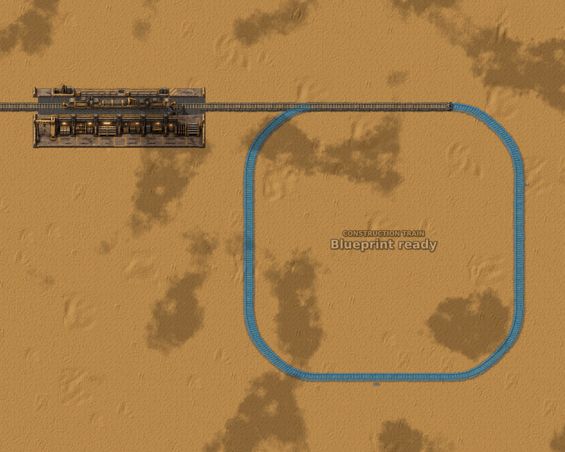

# Construction Train

**Place your railway blueprint. Let the construction train build it.**

Construction Train adds a dedicated railway workshop and a bidirectional construction train. It follows your planned network, lays real rails from the end of the existing track, installs signals and stops, resupplies at its depot and returns there when the job is done.

Designed for expanding large railway networks and city blocks.

## A complete workshop and train

Place the workshop on clear ground and rotate it with **R before placement**. It lays its own through track and creates its complete machine: **locomotive — materials wagon — locomotive**. Connect both ends to your railway network.

The workshop has a **100-slot inventory**, accessible manually or with inserters along its outer side. The materials wagon also has 100 slots. Supply construction materials and compatible fuel through the workshop; at the depot, it loads the wagon and fuels both locomotives.

**Only one construction train per planet.** The train belongs to its workshop and works in both directions.

## Build while moving

The train travels on real track and lays the next planned rail when its active nose reaches the construction joint. It slows down for construction instead of stopping for every rail. The working head's grabber animates after a successful placement.

Rails take priority. Signals and stops are installed along compatible journeys or on a later pass. A signal that would prevent the train from leaving or returning is deferred. When materials run low, the train returns to resupply and continues the job.

Trees, rocks and buildings must be cleared by you or your robots. A blocked rail puts construction on hold; the train rechecks the job and resumes after the obstruction is removed. Another buildable branch can be handled in the meantime.

## Choose what it builds

Four independent filters control construction:

- Rails.
- Rail signals.
- Rail chain signals.
- Train stops.

Only need rails and regular signals for your blocks? Enable those two categories. Excluded categories stay available to construction robots. You can also send the train to install only signals or stops on an existing connected network.

Each category has a separate loading target. Disabling a category keeps its target and the items already aboard.

## Reserve railway work for the train

An optional workshop setting reserves selected railway categories for the construction train **across the entire surface, for your force**. It is enabled by default when the workshop is placed. Robots already on their way may finish their work.

Disable this setting to let robots build those categories again. Categories excluded by the filters remain available to robots throughout.

## Fuel, ash and circuit networks

- Compatible locomotive fuels are supported, including modded fuels and item qualities. Fuel targets are measured in energy for each locomotive.
- Both locomotives unload burnt-fuel results, including **Pyanodon ash**, into the workshop when docked. Remove them with inserters. If storage is full, departure waits until unloading can finish.
- Red and green wires can read the **workshop inventory**, including qualities. The wagon and locomotive inventories are excluded; circuit signals do not control the train.

## Research and recipe

Research **Railway construction machinery**, after **Automated rail transportation**.

The vanilla workshop recipe includes its train and internal track:

- 2 locomotives, 1 cargo wagon and 4 steel chests.
- 40 steel plates, 40 iron gear wheels, 30 electronic circuits and 15 rails.

With **Pyanodon Coal Processing or Industry**, research follows the pack's automated railway technology. The recipe uses 15 circuits; with **Petroleum Handling**, the 40 gear wheels become 40 small parts, tier 1. The vehicles retain their normal recipe costs from the installed pack.

## Settings and recovery

Workshop blueprints preserve construction filters, loading targets, fuel reserve, robot reservation and circuit-reading options. Copying settings and cloning are supported. A workshop rebuilt from these settings waits in pause until you start it. Mining and placing an ordinary workshop item does not preserve settings.

Use the workshop panel to start, pause, recall or recover the machine. Recovery also handles its train away from the depot and drops stored items near their respective components. Occupants, moving vehicles or another train on the workshop's track delay recovery.

Before uninstalling, disable robot reservation or recover the workshop, then let the reserved ghosts finish returning to your force.

## Compatibility and scope

**Factorio 2.1.24 or later.** English and French interface. No required content mod.

Supports vanilla ground rails, ordinary and chain signals, train stops, item qualities and dedicated Pyanodon recipe/research integration. The train uses native pathfinding and railway signals. Planned track must connect to an accessible real railway; isolated ghosts are not reachable jobs.

Elevated rails, ramps, terrain clearing and construction of other buildings are outside the current scope. Traffic with production trains still needs a suitable railway layout and signalling. Very large existing plans can take time to reserve for the train.
