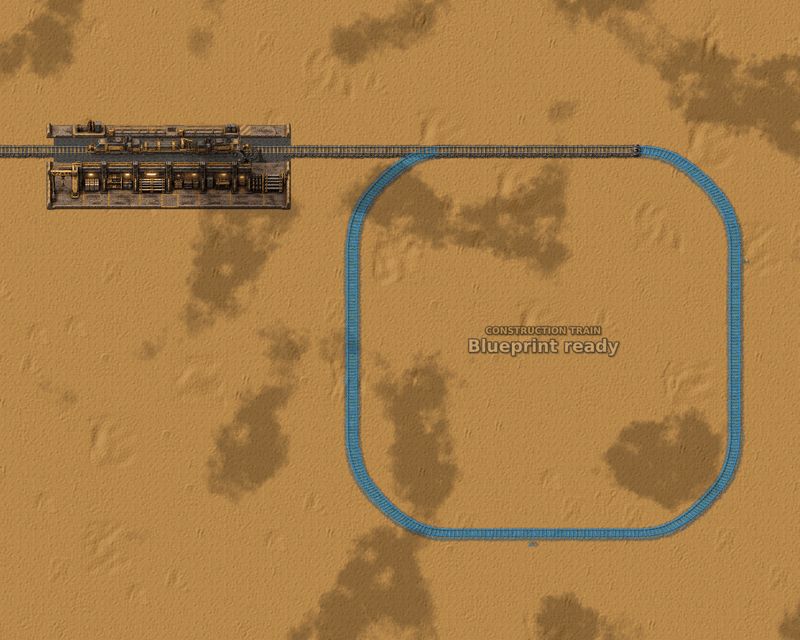

# Construction Train

**Posez votre plan ferroviaire. Le train de chantier le construit.**

Construction Train ajoute un atelier ferroviaire et son train de chantier bidirectionnel. Il suit le réseau que vous avez planifié, prolonge les voies réelles, installe les signaux et les arrêts, revient se ravitailler au dépôt et y attend une fois le chantier terminé.

Pensé pour l'extension des grands réseaux ferroviaires et des bases en blocs.

## Un atelier et son train complet

Posez l'atelier sur un terrain dégagé et orientez-le avec **R avant la pose**. Il crée sa propre voie traversante et sa machine complète : **locomotive — wagon de matériaux — locomotive**. Raccordez les deux extrémités à votre réseau ferroviaire.

L'atelier possède un **stock de 100 emplacements**, accessible à la main ou avec des bras le long de son côté extérieur. Le wagon de matériaux dispose également de 100 emplacements. Fournissez les matériaux et un carburant compatible dans l'atelier : au dépôt, il charge le wagon et le carburant des deux locomotives.

**Un seul train de chantier par planète.** Le train appartient à son atelier et travaille dans les deux sens.

## Construire en roulant

Le train circule sur les rails réels et pose le prochain rail prévu lorsque son nez actif atteint le joint de construction. Il ralentit pour travailler plutôt que de s'arrêter à chaque rail. La pince de la tête active s'anime après chaque pose réussie.

Les rails sont prioritaires. Les signaux et arrêts sont installés pendant les trajets compatibles ou lors d'un passage ultérieur. Un signal qui empêcherait le train de sortir ou de revenir est différé. Lorsque les matériaux manquent, le train retourne se ravitailler puis reprend le chantier.

Les arbres, rochers et bâtiments doivent être dégagés par vous ou vos robots. Un rail obstrué met le chantier en attente ; le train réexamine le travail et reprend après dégagement. Une autre branche constructible peut être traitée entre-temps.

## Choisir ce qu'il construit

Quatre filtres indépendants autorisent la construction :

- Des rails.
- Des signaux ferroviaires.
- Des signaux ferroviaires chaînés.
- Des arrêts de train.

Vos blocs utilisent seulement des rails et des signaux ordinaires ? Cochez ces deux catégories. Les catégories exclues restent disponibles pour les robots de construction. Le train peut aussi installer uniquement les signaux ou les arrêts sur un réseau existant raccordé.

Chaque catégorie possède sa propre quantité cible de chargement. La désactiver conserve sa cible et les objets déjà embarqués.

## Réserver le chantier ferroviaire au train

Une option de l'atelier réserve les catégories ferroviaires sélectionnées au train de chantier **sur toute la surface, pour votre force**. Elle est activée par défaut à la pose de l'atelier. Les robots déjà en route peuvent terminer leur travail.

Désactivez cette option pour rendre ces catégories aux robots. Les catégories exclues par les filtres restent toujours disponibles pour eux.

## Carburant, cendres et réseaux logiques

- Les carburants compatibles avec les locomotives sont acceptés, y compris ceux des mods et les qualités. La réserve cible est calculée en énergie pour chaque locomotive.
- Les deux locomotives déchargent leurs résidus, notamment les **cendres Pyanodon**, dans l'atelier lorsqu'elles sont au quai. Des bras peuvent les extraire. Si le stock est plein, le départ attend la fin du déchargement.
- Les fils rouge et vert lisent le **stock de l'atelier**, qualités comprises. Les inventaires du wagon et des locomotives sont exclus ; les signaux logiques ne commandent pas le train.

## Recherche et fabrication

Recherchez **Construction ferroviaire spécialisée**, après **Transport ferroviaire automatisé**.

La recette du jeu de base comprend le train et la voie interne :

- 2 locomotives, 1 wagon de marchandises et 4 coffres en acier.
- 40 plaques d'acier, 40 engrenages, 30 circuits électroniques et 15 rails.

Avec **Pyanodon Coal Processing ou Industry**, la recherche suit celle du ferroviaire automatisé du pack. La recette utilise 15 circuits ; avec **Petroleum Handling**, les 40 engrenages sont remplacés par 40 petites pièces de niveau 1. Les véhicules conservent leur coût de fabrication dans le pack installé.

## Réglages et récupération

Les plans de l'atelier mémorisent les filtres de construction, quantités cibles, réserve de carburant, réservation des robots et options de lecture logique. La copie des réglages et le clonage sont pris en charge. Un atelier reconstruit avec ces réglages attend en pause votre démarrage. Miner puis reposer un objet atelier ordinaire ne conserve pas les réglages.

Le panneau de l'atelier permet de démarrer, mettre en pause ou rappeler la machine. Pour récupérer l'ensemble, minez l'atelier ou demandez sa déconstruction par les robots. La récupération prend aussi en charge le train éloigné du dépôt et dépose les objets stockés près de leurs composants respectifs. Un occupant, un véhicule mobile ou un autre train sur la voie de l'atelier diffère cette récupération.

Avant de désinstaller, désactivez la réservation des robots ou récupérez l'atelier, puis laissez les fantômes réservés terminer leur restitution à votre force.

## Compatibilité et périmètre

**Factorio 2.1.24 ou ultérieur.** Interface française et anglaise. Aucun mod de contenu obligatoire.

Prise en charge des rails vanilla au sol, signaux ordinaires et chaînés, arrêts, qualités, ainsi que d'une adaptation dédiée des recettes et recherches Pyanodon. Le train utilise la recherche de chemin et la signalisation natives. Le plan doit être raccordé à une voie réelle accessible ; des fantômes isolés ne sont pas un chantier atteignable.

Les rails surélevés, rampes, travaux de terrain et constructions d'autres bâtiments sont hors périmètre actuel. La cohabitation avec les trains de production demande toujours un réseau et une signalisation adaptés. La réservation d'un très grand plan déjà posé peut prendre du temps.
